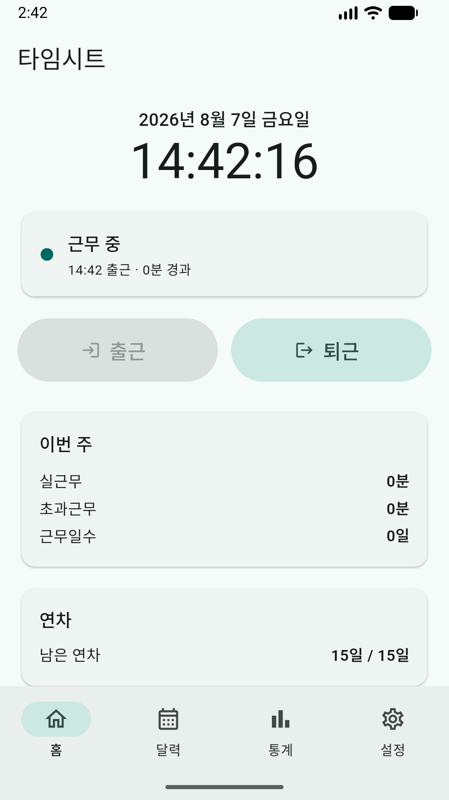
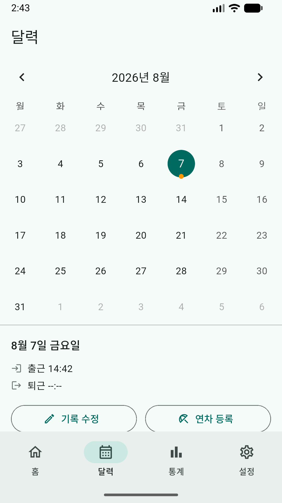
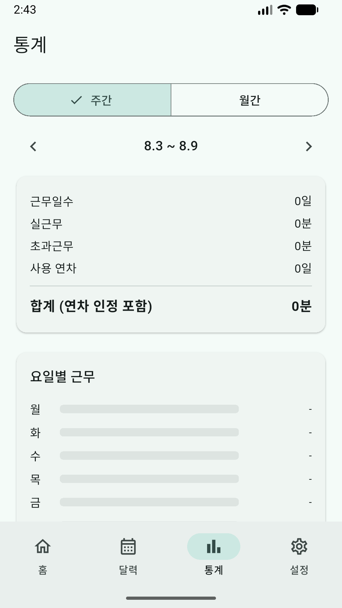
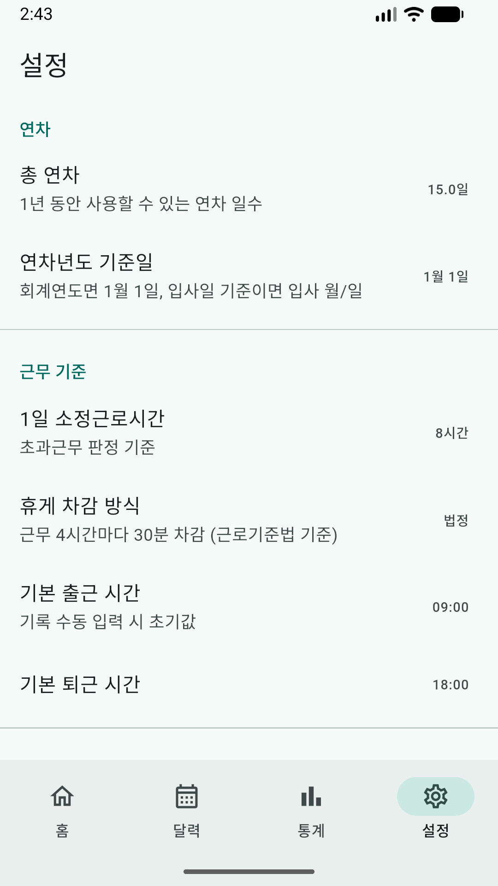

# 출퇴근기록장 (timesheet)

버튼 한 번으로 출퇴근을 기록하고 근무시간과 연차를 자동으로 계산하는 Flutter 앱.

자체 서버가 없어 **출퇴근 기록·연차·설정은 모두 기기 안(sqlite, SharedPreferences)에만** 저장됩니다.
회원가입이 없고 기록이 외부로 전송되지 않아, 비행기 모드에서도 모든 기능이 그대로 동작합니다.
네트워크는 배너 광고를 불러올 때만 사용합니다([광고](#광고) 참고).

<p>
  <a href="https://apps.apple.com/kr/app/id6798968684"></a>
  <a href="https://play.google.com/store/apps/details?id=io.pinkspider.timesheet"></a>
</p>

| 홈 | 달력 | 통계 | 설정 |
|---|---|---|---|
|  |  |  |  |

## 주요 기능

- **원터치 출퇴근 기록** — 출근/퇴근 버튼 한 번, 앱 아이콘 길게 눌러 바로 기록(퀵 액션)
- **오프라인 달력** — 지난 기록 확인, 놓친 기록 추가·수정
- **주간·월간 통계** — 실근무시간, 초과근무, 근무일수 자동 집계
- **연차 관리** — 반차 지원, 연차년도 기준일 설정, 남은 연차 자동 계산
- **휴게시간 자동 차감** — 근로기준법 기준(4시간마다 30분) 또는 고정 차감 선택
- **퇴근 리마인더** — 출근 시각 + 설정한 시간이 지나면 알림
- **CSV 내보내기 / JSON 백업·복원**
- **광고 제거** — 한 번의 인앱결제로 모든 광고 제거, 재설치·기기 변경 시 구매 복원

## 광고

- 배너 광고는 **달력·통계 탭에서만** 표시됩니다. 홈·설정 화면과 퀵 액션으로 기록하는 경로에는 광고가 없습니다.
- 설정 > 광고 > **광고 제거**를 한 번 구매하면 이후 광고가 사라지고 광고 SDK 자체를 초기화하지 않습니다.
- iOS는 첫 실행 시 추적 권한(ATT)을 묻습니다. "허용 안 함"을 선택해도 맞춤 광고만 빠질 뿐, 모든 기능을 동일하게 사용할 수 있습니다.

## 개발

```sh
flutter pub get
flutter run
flutter test
```

빌드·배포 명령과 아키텍처 설명은 [CLAUDE.md](CLAUDE.md)를 참고하세요.

- Flutter (Dart SDK ^3.12.2), Android / iOS 타겟
- 데이터: sqflite + SharedPreferences (기록은 외부로 전송되지 않음)
- 알림: flutter_local_notifications, 달력: table_calendar
- 광고·결제: google_mobile_ads(UMP 동의 포함), in_app_purchase, app_tracking_transparency
- 도메인 규칙(휴게 차감, 주 경계, 연차년도 등)은 `lib/utils/time_calculator.dart` 순수 함수 계층에 집약

## 개인정보

출퇴근 기록·연차·설정 등 **앱이 만드는 데이터는 수집하지 않으며 기기를 떠나지 않습니다.**
다만 광고 표시를 위해 Google AdMob SDK가 광고 식별자·기기 정보 등을 수집할 수 있습니다.

자세한 내용은 [개인정보처리방침](https://pink-spider.github.io/timesheet-privacy/)을 참고하세요.

## 라이선스

소스 코드는 [GPL-3.0](LICENSE)입니다. 이 코드로 앱을 만들어 배포하면 그 소스도 같은 조건으로
공개해야 합니다. 다음은 GPL 대상이 **아니며** 모든 권리를 보유합니다: 앱 이름 '출퇴근기록장',
아이콘·브랜드 자산(`assets/icon/`), 스토어 제출 자산과 등록 문구(`store/`).
pub.dev에는 배포하지 않습니다 (`publish_to: none`).
© 2026 Pink Spider
